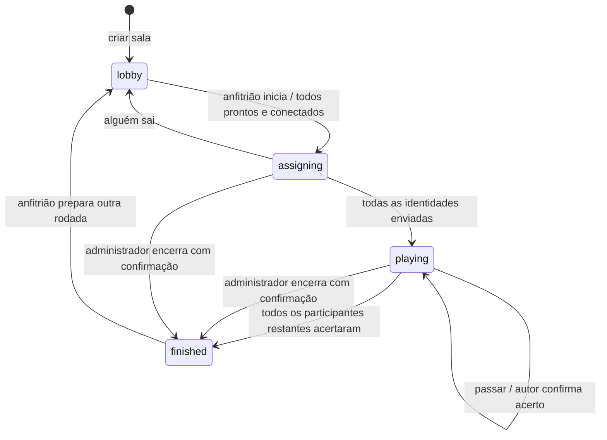

# Arquitetura do Whoami 2

## Decisões

O frontend é uma SPA React/TypeScript com Vite. Não existe necessidade de SSR para o tabuleiro privado. Tailwind fornece os tokens/utilitários; shadcn/ui fornece componentes locais sobre Radix para diálogos, botões, inputs e tooltips. Motion anima entrada de cartas e transições de etapas, respeitando a preferência de movimento reduzido. Outfit e Geist Mono são servidas localmente. A ilustração da entrada é um asset WebP de aproximadamente 107 KB, sem renderização 3D em tempo real.

O backend é uma aplicação NestJS. `GameGateway` administra transporte, ACK, origem, presença e limites. `GameService` é a autoridade das regras. `DatabaseService` guarda snapshots, sessões e recibos em SQLite com WAL, chaves estrangeiras e transações síncronas. Há um limite defensivo de 250 salas por instância e 12 jogadores por sala.

`packages/shared` compila os contratos em ESM e CommonJS, com declarações TypeScript. O frontend e o backend usam os mesmos schemas Zod. TypeScript 5.9 foi mantido por compatibilidade com o intervalo oficialmente suportado pelo typescript-eslint instalado; as versões principais das aplicações foram atualizadas e estão fixadas no lockfile.

## Máquina de estados

A ordem de entrada é a ordem inicial dos assentos. O administrador pode reorganizá-la na espera; isso invalida a prontidão anterior. Essa ordem determina a atribuição circular de identidades e os turnos. A visualização gira a roda para mostrar o jogador local embaixo, preservando a vizinhança e o sentido horário. Uma pessoa descoberta mantém seu lugar, mas sai da fila de perguntas. A lista não muda enquanto as pessoas escolhem cartas; uma saída nessa fase invalida a distribuição e retorna à espera. Durante o jogo, quem sai fica marcado como ausente na rodada, sem redistribuir identidades já vistas. A próxima rodada elimina esses lugares antigos.

Não há cronômetro, pontos ou ranking. O turno só muda por ação explícita ou saída/recuperação de participantes. Só o autor da identidade (`assignmentTargetId` da sessão) pode confirmar o acerto do jogador correspondente, inclusive quando não é a vez dele. O servidor verifica a autoria e a rodada. Confirmar uma pessoa fora do turno não interrompe quem está perguntando; confirmar a pessoa ativa avança a vez. Todos os acertos exigem uma confirmação na interface. O administrador pode encerrar a partida antecipadamente, também com confirmação. Não há reconhecimento de voz ou avaliação automática do palpite.

As sugestões são dados locais compartilhados: 60 por categoria temática, 270 em Tudo vale. O sorteio remove a opção da lista disponível até esgotar o conjunto e evita repetir o valor atual na renovação.

## Identidade e privacidade

O cliente gera um token criptográfico de 256 bits e o armazena no navegador. A criação e a entrada vinculam o hash SHA-256 desse token a um jogador UUID e a uma sala. O backend não armazena o token em texto claro e não usa `socket.id` como identidade da pessoa.

Cada cliente recebe uma projeção própria do estado. A identidade própria é `null` até o acerto ou o resultado; durante a atribuição, todas as identidades são ocultadas, exceto a que a própria pessoa escreveu para outra. A identidade secreta nunca é enviada para ser apenas escondida com CSS. A string `hidden` deixou de ser um marcador e pode ser uma identidade literal.

O token é uma credencial de acesso. Use HTTPS, não registre tokens em logs e mantenha o volume/banco fora do repositório. Não há contas de usuário ou dados pessoais além do apelido escolhido. Limpar o armazenamento do navegador perde a credencial; o código da sala sozinho não recupera um lugar antigo. Uma nova aba com a mesma sessão substitui a conexão anterior para evitar ações concorrentes de duas telas.

## Protocolo

| Evento                 | Direção            | Responsabilidade                                  |
| ---------------------- | ------------------ | ------------------------------------------------- |
| handshake `auth.token` | cliente → servidor | Identificação da sessão antes de mensagens        |
| `command`              | cliente → servidor | Comando validado com UUID de solicitação e ACK    |
| `sync`                 | cliente → servidor | Busca da projeção atual com ACK                   |
| `ping`                 | cliente → servidor | Medição de tempo de ida e volta                   |
| `room:state`           | servidor → cliente | Snapshot completo e privado com versão monotônica |
| `session:replaced`     | servidor → cliente | Aviso de que outra aba assumiu a sessão           |
| `room:closed`          | servidor → cliente | Sala encerrada/expirada                           |

Comandos: `room:create`, `room:join`, `room:ready`, `room:settings`, `room:begin`, `identity:set`, `turn:pass`, `player:solve`, `room:seats`, `room:finish`, `room:restart`, `room:leave`.

## Recuperação e consistência

- O Socket.IO inicia em HTTP polling e promove a conexão para WebSocket quando disponível, mantendo polling quando a promoção é bloqueada; o cliente reconecta com espera progressiva e aleatória entre tentativas.
- Há heartbeat no servidor, sincronização após conectar e ao voltar à aba, atualização de presença e medição de latência. A recuperação do transporte é complementada pela recuperação da aplicação.
- Ao perder a rede, a tela conserva o último snapshot e bloqueia comandos. O lugar permanece reservado por 120 segundos. Se o armazenamento estiver bloqueado, o navegador informa que a recarga pode perder a sessão.
- Cada comando tem um `requestId`. O servidor guarda um recibo junto à mutação em transação. Se o ACK se perde, o cliente reenvia o mesmo ID uma vez: a alteração não é aplicada de novo. O ID reutilizado com outro conteúdo é rejeitado.
- `identity:set`, `player:solve` e `room:finish` incluem a rodada; a confirmação de acerto também identifica o jogador. `turn:pass` inclui um `turnId` único. Cliques atrasados não alteram outra pessoa ou uma rodada futura. `room:seats` aceita apenas uma permutação exata dos jogadores atuais e só na espera.
- Snapshots antigos não substituem uma versão mais nova no cliente.
- Um reinício carrega as salas do SQLite, marca todos como offline e reabre a janela de recuperação. A ordem, a autoria e os segredos são preservados. Snapshots do formato anterior têm os campos de cronômetro/pontos removidos ao carregar, sem apagar a sala.
- Se ninguém elegível está conectado, a próxima vez fica pausada até alguém voltar. Um anfitrião pode avançar uma vez; uma pessoa desconectada é removida após a janela de recuperação.

## Limites explícitos

Uma instância é a autoridade de cada sala. Duas instâncias com processos/arquivos separados não compartilham partida. O simples uso de Redis Pub/Sub não torna as transações distribuídas nem garante recuperação. Antes de múltiplas réplicas, implemente ownership de salas ou estado/locks transacionais centralizados e um adapter compatível.

Salas inativas expiram em 24 horas. Recibos são mantidos por 24 horas. O histórico de atividade de cada sala guarda os últimos 25 eventos. As ações são limitadas por sessão e tentativas de conexão por endereço de origem; proxies devem ser considerados ao calibrar esses limites. O jogo não inclui moderação automática, chat, áudio/vídeo, matchmaking público ou ranking global.

## Verificação

Vitest exercita regras, permissões, segredo, repetição segura, versões de turno, limite de pessoas, retorno ao lobby, ausência de avanço por tempo, autoria, ordem dos assentos, encerramento antecipado, sugestões sem repetição, expiração, migração do anfitrião e persistência. A integração sobe um NestJS real com SQLite e conecta clientes WebSocket e polling. Playwright joga uma rodada entre dois contextos, testa refresh/offline e as telas em vários tamanhos; axe-core verifica acessibilidade nas telas cobertas.

## Histórico

O repositório `whoami` continua oficial. Os históricos anteriores do frontend (`4f86810`) e da API (`487faf8`) permanecem ancestrais. A versão 1 do monorepo foi consolidada em `de63a03`; a versão 2 substitui Next.js/Material UI/JavaScript, sem apagar esses commits.
