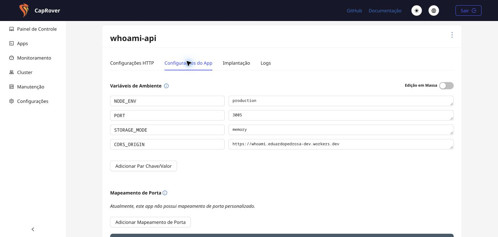
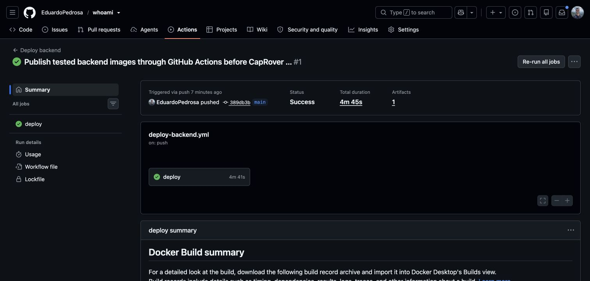

# Publicação na Cloudflare e no CapRover

## Ambientes

- Jogo: https://whoami.eduardopedrosa-dev.workers.dev
- API: https://whoami-api.eplabs.com.br
- Saúde: https://whoami-api.eplabs.com.br/api/health
- Configuração reproduzível: [Cloudflare e CapRover](../cloudflare-caprover.md).

O frontend é servido pelo Worker `whoami`, com arquivos estáticos e fallback de SPA. O backend permanece NestJS/Socket.IO, em uma instância do app `whoami-api` no CapRover, com HTTPS, WebSocket e porta interna 3005. `STORAGE_MODE=memory` dispensa banco e volume; reinícios e atualizações encerram as salas abertas. Reconexões de rede preservam o lugar por dois minutos enquanto o processo está ativo.

## Entrega automatizada

O registry global do CapRover recusou push da imagem por falta de escopo no token existente. A publicação passou a ocorrer no GitHub Actions, usando o `GITHUB_TOKEN` temporário do repositório e um segredo `CAPROVER_APP_TOKEN` exclusivo desse aplicativo. A configuração do registry compartilhada com outros apps foi preservada.

O workflow testa a imagem antes de publicá-la e informa ao CapRover o digest imutável. O webhook direto de push e os builds do Worker antigo `whoami-api` ficaram desativados. O frontend continua publicado automaticamente pela integração Git da Cloudflare.

- [Deploy backend aprovado](https://github.com/EduardoPedrosa/whoami/actions/runs/39705917951).
- [CI aprovado](https://github.com/EduardoPedrosa/whoami/actions/runs/39705918015).
- Código da imagem validada: `389db3bf80632ea2cee5180608166ee17f416e6c`.
- Imagem: `ghcr.io/eduardopedrosa/whoami-api@sha256:bcd36d99c2d9e06878f0e475ac75fddbae8befc21a13d71798de656721ce3645`.

## Verificação

| Verificação                    | Resultado                                                                                           |
| ------------------------------ | --------------------------------------------------------------------------------------------------- |
| Lint, TypeScript e build       | Aprovados                                                                                           |
| Formatação                     | Aprovada                                                                                            |
| Regras, sugestões e integração | 43 testes aprovados; regras com SQLite e memória, transporte real em memória                        |
| Navegador local em memória     | 6 cenários aprovados                                                                                |
| Navegador na publicação        | 6 cenários aprovados: cinco na suíte inicial e roda com 12 após configurar a origem separada da API |
| Rodada com duas pessoas        | Atribuição privada, confirmação pelo autor, resultado e nova rodada                                 |
| Rede e sessão                  | Refresh, offline, reconexão e fallback para polling                                                 |
| Roda com 12 pessoas            | Assentos, reordenação, autoria, encerramento com confirmação e layouts em 1440, 1024, 375 e 320px   |
| Origem autorizada              | Polling HTTP 200 com a origem exata do frontend                                                     |
| Origem não autorizada          | HTTP 403 sem autorização CORS                                                                       |
| Saúde pública                  | HTTP 200 e `status: ok`                                                                             |

O teste da roda usa clientes Socket.IO fora do navegador para preparar 12 lugares. Em hospedagens separadas, `E2E_SOCKET_URL` aponta para a API e `E2E_BASE_URL` para o frontend. O ajuste desse teste não altera o transporte da aplicação.

Os testes de navegador usam Chrome, celulares emulados e axe-core. Não equivalem a testes em aparelhos físicos ou a um teste de carga.

## Evidências

