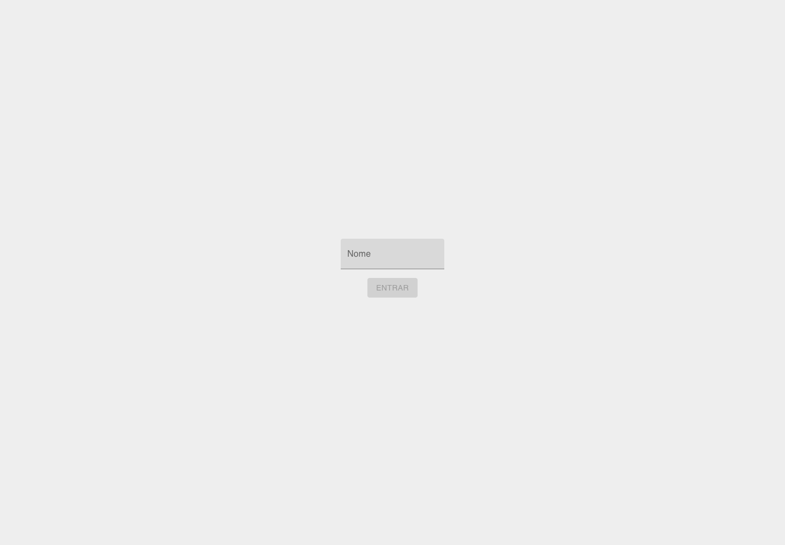
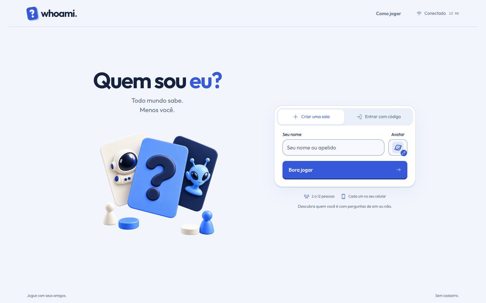
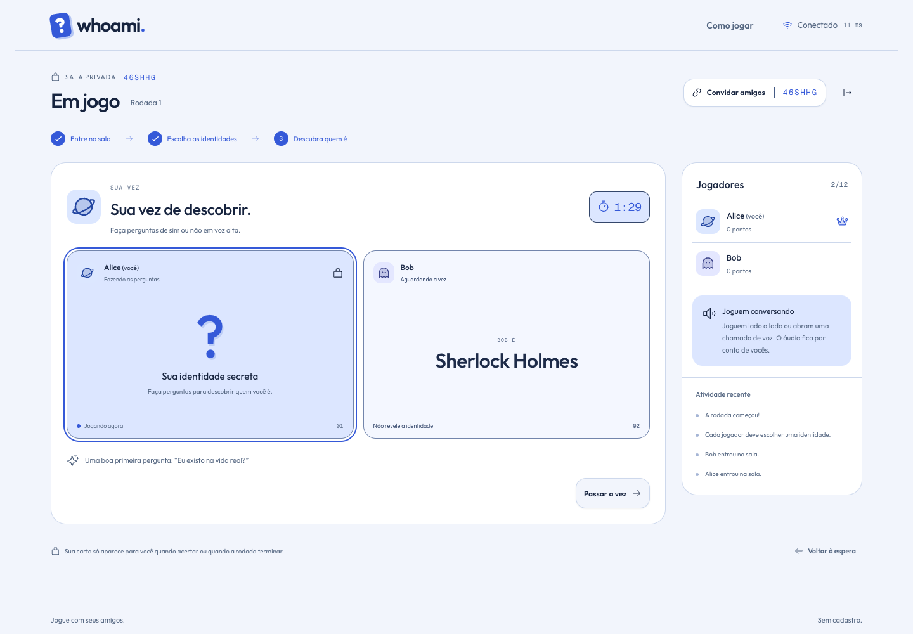
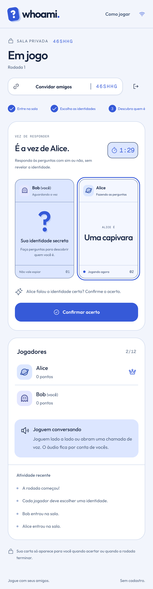
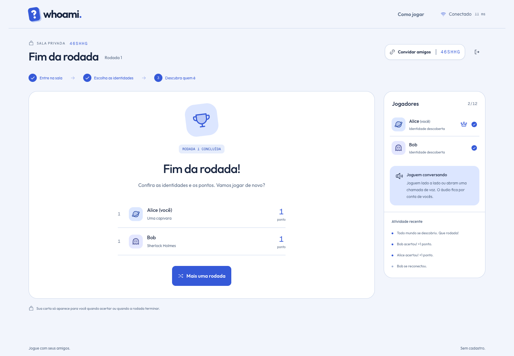

# Validação da versão 2

Executada em 21/10/2026, macOS/Apple Silicon com Node 22.21.1 e Chrome. O empacotamento de produção foi compilado e executado em Linux ARM64 pelo Docker/Colima.

| Verificação                                 | Resultado                                                                                     |
| ------------------------------------------- | --------------------------------------------------------------------------------------------- |
| ESLint                                      | Sem erros ou avisos de lint                                                                   |
| TypeScript                                  | Frontend, backend, contratos, testes e configuração sem erros                                 |
| Prettier                                    | Padrão consistente em todos os arquivos cobertos                                              |
| Build local                                 | Contratos ESM/CJS, NestJS e Vite compilados                                                   |
| Vitest                                      | 18 testes de regras, persistência e integração reais passaram                                 |
| Playwright em produção Docker               | 5 testes passaram sobre Nginx + NestJS                                                        |
| Acessibilidade axe-core                     | Sem violações nas telas cobertas: entrada, ajuda, espera, atribuição, partida e resultado     |
| Responsividade                              | 320, 375, 390, 768, 812, 1024 e 1440px; verificações de overflow e capturas                   |
| WebSocket bloqueado                         | Entrada e comando de prontidão funcionam por polling                                          |
| Rede offline e refresh                      | Retorno à mesma partida e identidade, sem revelar a própria carta                             |
| Reinício real do container                  | Dois clientes reconectaram à sala persistida com os mesmos IDs e segredo preservado           |
| UUID indisponível em contexto de rede local | Criação e comandos com fallback criptográfico passaram                                        |
| Auditoria das dependências de produção      | 213 dependências avaliadas, zero vulnerabilidades conhecidas no momento da consulta           |
| Docker                                      | Imagens de frontend/backend compiladas, healthcheck saudável, proxy HTTP/WebSocket verificado |

A auditoria não prevê vulnerabilidades futuras. Os testes não representam teste de carga ou cobertura automática de Safari/iOS/Firefox. O limite de salas é defensivo e não uma capacidade medida. A topologia entregue usa uma instância autoritativa com volume persistente.

## Revisão de texto e paleta azul

O título passou a ser **Quem sou eu?**, com **Todo mundo sabe. Menos você.** como subtítulo. Os textos de entrada, regras, convites, atividade e resultados ficaram mais diretos. A paleta e a arte foram atualizadas para azul; o placeholder do código foi simplificado e o cabeçalho recebeu padding explícito.

Validação desta revisão: 18 testes de backend e 5 testes de navegador aprovados, build Docker e checagens de lint, tipos e formatação aprovados. Os testes de navegador foram executados sobre o build de produção em Nginx + NestJS.

A espera, escolha de identidades, partida e resultados foram conferidos em 320, 375 e 812px, além da página inicial nos demais tamanhos já cobertos. Convite, ajuda e confirmação foram verificados em telas baixas, com rolagem interna. A auditoria axe-core passou após o ajuste de contraste dos textos nas cartas claras. O padding do cabeçalho também passou a ser verificado nos testes de layout.

Uma verificação adicional com eventos de toque em celular emulado passou por criação de sala, abertura/fechamento do convite e saída. Isso não equivale a testes em aparelhos físicos ou Safari/iOS.

## Menu de jogo e tema claro

A entrada agora usa tema claro, azul cobalto e ilustração com transparência. O cabeçalho acompanha a página e não fica fixo. Nome e avatar ficam na mesma linha; os oito avatares continuam disponíveis em uma janela acessível, com retorno do foco ao botão após fechar.

O menu foi verificado sem rolagem vertical nos modos criar e entrar em 1440 × 1000, 1024 × 768, 768 × 1024, 375 × 812, 320 × 700, 320 × 568, 812 × 375 e 667 × 375. O teste verifica a altura do documento e a posição do título, ilustração, informações e botão principal. Em paisagem, as informações ocupam a coluna da ilustração para liberar espaço ao formulário.

A rolagem permanece disponível quando necessária, por exemplo com teclado aberto, zoom, avisos ou mensagens de validação. Não há bloqueio global de overflow. A sala e os diálogos também usam o tema claro. A auditoria axe-core cobre a nova escolha de avatar e as telas da partida. Os cinco testes de navegador passaram também no build de produção via Docker; a entrada do segundo jogador inclui seleção do avatar por toque.

## Antes e depois

## Partida

## Resultado

